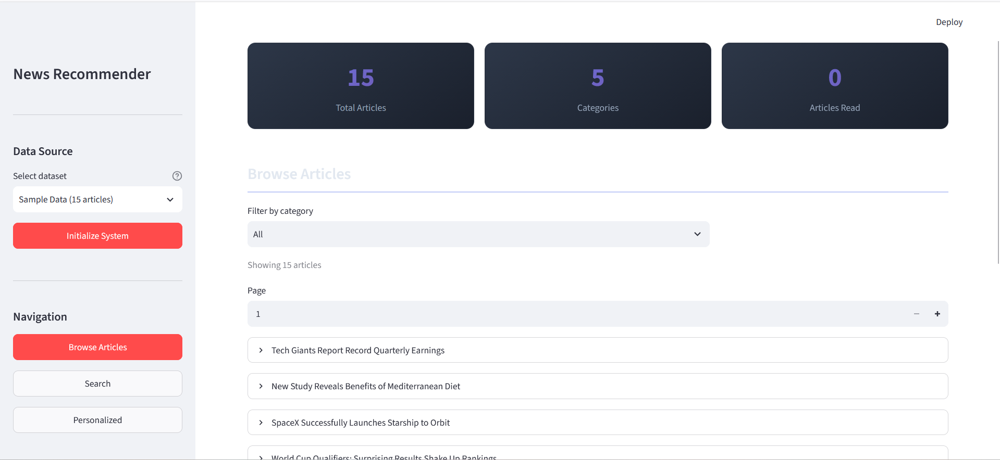

# News Article Recommender System

A semantic news recommender that understands what articles are *about*, not just which words they share. Articles are embedded with **DistilBERT**, indexed with **FAISS**, and served through an interactive **Streamlit** news portal with browsing, semantic search and personalized recommendations.

> CSC 4352 (NLP + Transformers) final project, Al Akhawayn University, by **Ghita Nafa & Lina Harcharras**.



## Features

- **Similar articles**: pick any article and get the most semantically similar ones, with similarity scores.
- **Semantic search**: natural-language queries matched by meaning rather than exact keywords.
- **Personalized feed**: builds a user profile from reading history and recommends unread articles that match it.
- **Category filtering** and pagination for browsing.
- **Topic clustering** (optional): K-means / HDBSCAN clusters visualized with UMAP.

## How It Works

1. **Preprocessing**: removes HTML, URLs and emails, normalizes Unicode and whitespace.
2. **Embeddings**: DistilBERT with mean pooling turns each article into a normalized 768-dimensional vector.
3. **Indexing**: vectors are stored in a FAISS `IndexFlatIP` index. For normalized vectors, inner product equals cosine similarity.
4. **Recommendation**: the seed article's vector queries FAISS for the top-K neighbors; already-read articles are filtered out and the rest are ranked by similarity.
5. **Personalization**: the user profile is the normalized mean of the embeddings of articles read so far (at least 2 needed).

```
Streamlit UI ──► Recommendation engine ──► DistilBERT embeddings ──► FAISS index ──► Article store
```

## Datasets

| Dataset | Size | Categories |
|---|---|---|
| Sample data (default) | 15 hand-written articles | World, Sports, Business, Sci/Tech, Health |
| [AG News](https://huggingface.co/datasets/ag_news) | 120,000 articles (100–10,000 loaded in the app) | World, Sports, Business, Sci/Tech |

AG News is downloaded automatically through HuggingFace Datasets on first use.

## Getting Started

```bash
git clone https://github.com/linahrchrs/news-recommender.git
cd news-recommender
python -m venv venv && source venv/bin/activate   # Windows: venv\Scripts\activate
pip install -r requirements.txt
streamlit run app.py
```

Then open http://localhost:8501, choose a dataset in the sidebar and click **Initialize System**. The first run downloads the DistilBERT model (~250 MB).

Other options:
- `bash setup.sh --venv` creates a virtual environment, installs dependencies and runs quick checks.
- `python demo.py` runs every component from the command line.
- For topic clustering, also run `pip install hdbscan umap-learn plotly`.

## Project Structure

```
news-recommender/
├── app.py               # Streamlit application (browse, search, personalized views)
├── demo.py              # Command-line demo of all components
├── config.py            # Model, FAISS, dataset and UI settings
├── setup.sh             # Setup and sanity-check script
├── data/
│   └── data_loader.py   # NewsArticle schema, sample data, AG News / BBC / MIND loaders
├── models/
│   ├── embeddings.py    # DistilBERT embedding generation (CLS / mean / max pooling)
│   ├── vector_db.py     # FAISS index wrapper (flat IP, flat L2, IVF)
│   ├── recommender.py   # Recommendation engine and user profiles
│   └── clustering.py    # Topic clustering and visualization
├── utils/
│   └── preprocessing.py # Text cleaning pipeline
└── Report.pdf           # Project report
```

## Using the Components Directly

```python
from models import RecommendationEngine
from data.data_loader import load_sample_data

engine = RecommendationEngine()
articles = [a.to_dict() for a in load_sample_data().articles]
engine.index_articles(articles)

engine.get_recommendations(article_id="sample_001", n_recommendations=5)
engine.search_by_query("artificial intelligence regulation")

engine.mark_as_read("sample_001")
engine.mark_as_read("sample_002")
engine.get_personalized_recommendations()
```

## Configuration

All settings live in `config.py`: model name and pooling strategy, FAISS index type, number of recommendations, similarity threshold, and UI options. For example, switching `model_name` to `bert-base-uncased` trades speed for quality.

## Tech Stack

Python · PyTorch · HuggingFace Transformers (DistilBERT) · FAISS · Streamlit · scikit-learn · HuggingFace Datasets

## Authors

- **Ghita Nafa**. [GitHub](https://github.com/Ghita05)
- **Lina Harcharras**. [GitHub](https://github.com/linahrchrs)

Originally developed in [Ghita05/CSC_4352_Projects](https://github.com/Ghita05/CSC_4352_Projects/tree/main/FinalProject). Full details are in [Report.pdf](Report.pdf).

## References

- Devlin et al. (2019). *BERT: Pre-training of Deep Bidirectional Transformers for Language Understanding.*
- Sanh et al. (2019). *DistilBERT, a distilled version of BERT.*
- Johnson et al. (2019). *Billion-scale similarity search with GPUs* (FAISS).